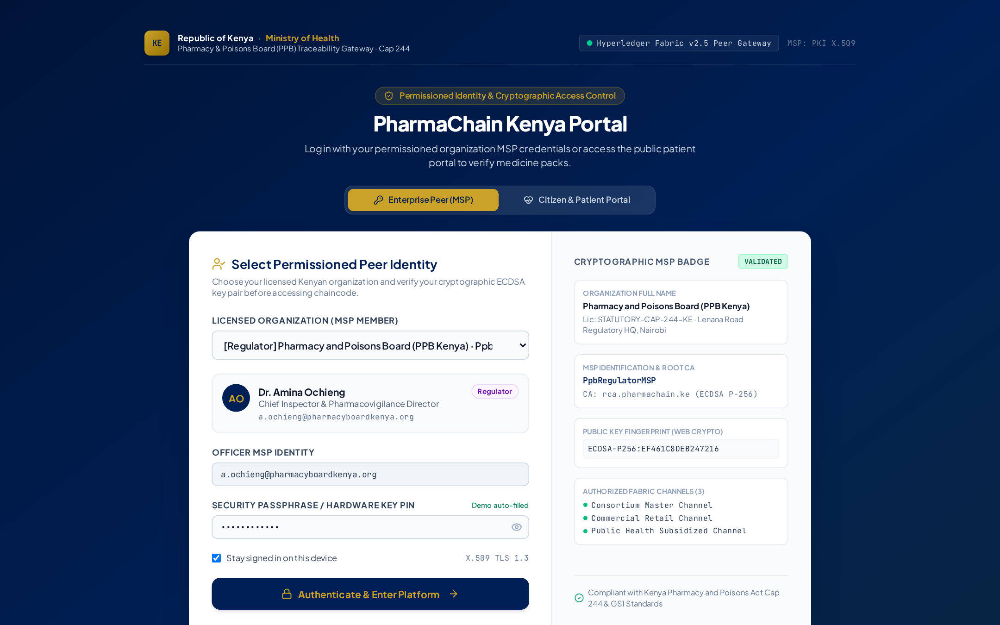
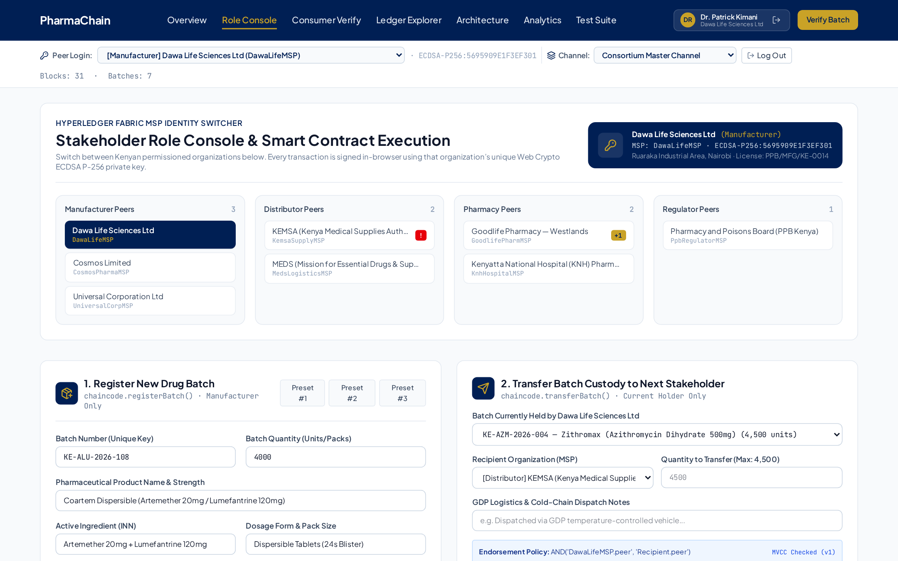
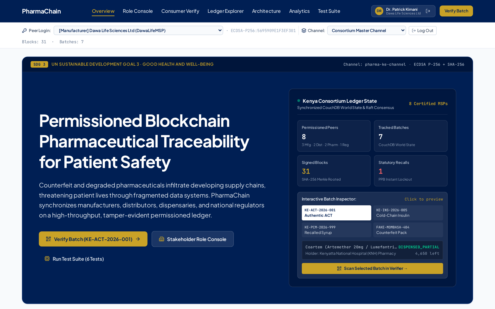
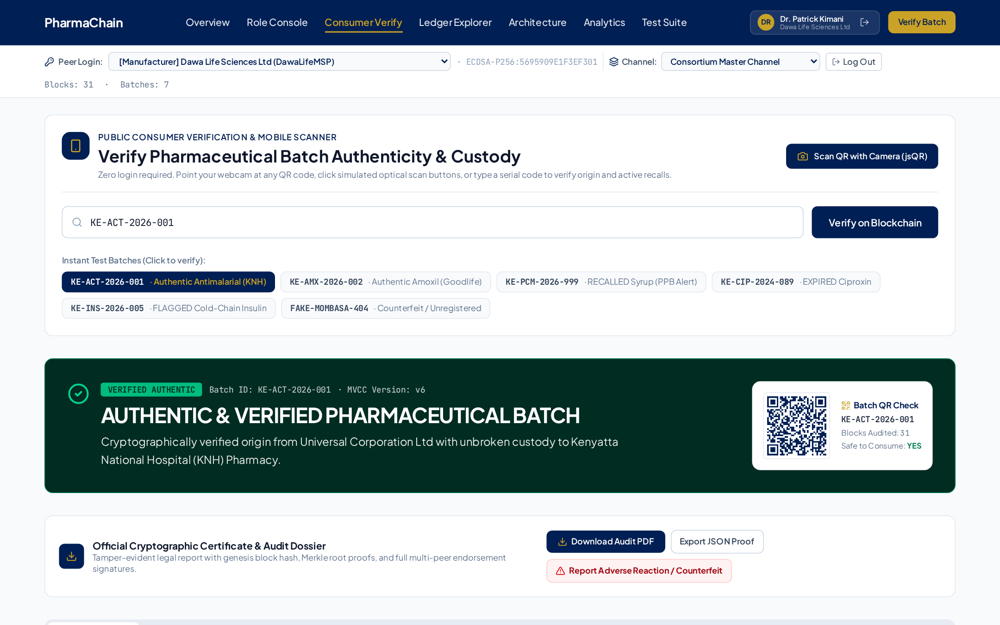
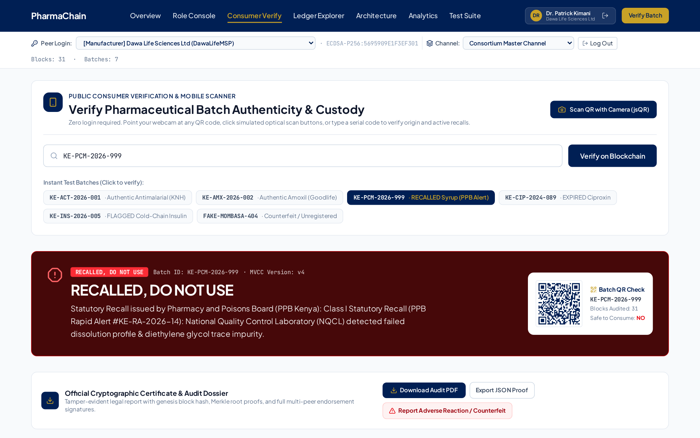
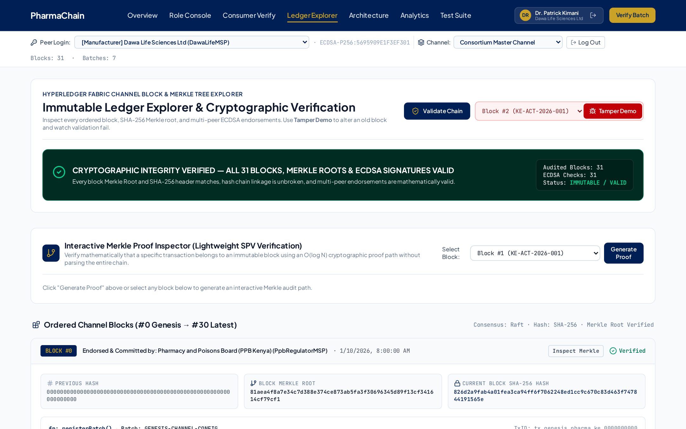
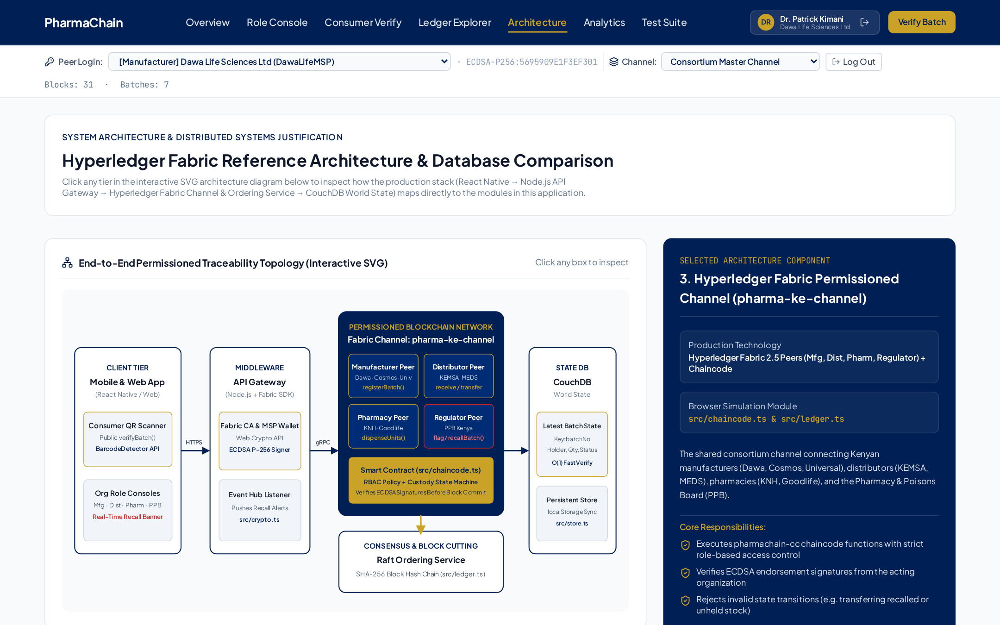
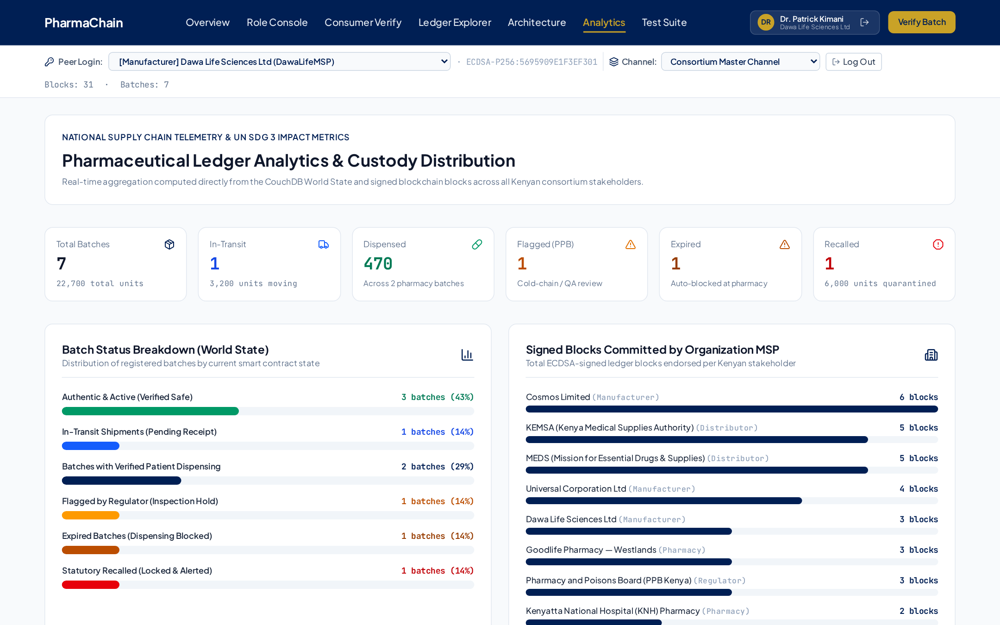
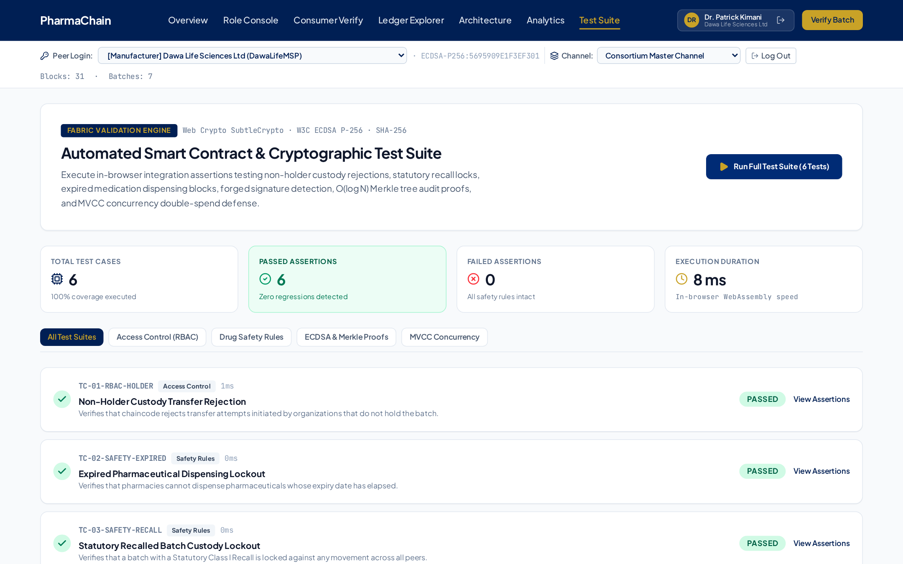

# PharmaChain Kenya — SDG 3 Drug Traceability Ledger

PharmaChain is a blockchain-powered pharmaceutical traceability platform designed to improve drug safety, reduce counterfeit medicines, and support the UN Sustainable Development Goal 3: Good Health and Well-Being. The project combines a permissioned Hyperledger Fabric ledger, a browser-based operations dashboard, and a consumer verification workflow for batch-level drug authenticity checks.

## Why this project matters

Counterfeit and substandard medicines remain a major public health risk. PharmaChain helps stakeholders across the supply chain — regulators, manufacturers, distributors, pharmacies, and patients — verify the provenance and integrity of each batch using secure, tamper-evident records.

Key outcomes:

- Trace every batch from manufacturer to end consumer
- Detect counterfeit, expired, or recalled stock quickly
- Give regulators a transparent audit trail for compliance
- Allow consumers to verify medicines using a secure look-up workflow
- Provide a realistic demo of blockchain governance in a healthcare context

## Product overview

This repository contains a full-stack drug traceability platform:

- Web dashboard for end-to-end pharmaceutical operations
- Express API gateway for ledger interaction and verification
- Hyperledger Fabric network for record immutability and permissioned access
- Apache CouchDB for state and block storage
- React Native mobile companion app for field verification and scanning

## Core capabilities

- Batch traceability across distribution and custody events
- Role-based access for authorized organizations and officers
- Real-time recall alerts and quarantine state handling
- Consumer verification by batch number and QR-based product checks
- Ledger explorer with block and Merkle-style validation visibility
- Analytics dashboard for compliance and operational monitoring
- Automated test suite for validation scenarios
- Secure cryptographic identity flow using Web Crypto and ECDSA-style workflows

## Architecture at a glance

```text
Browser / Mobile Client
        │
        ▼
  React + Vite Frontend
        │
        ▼
  Express API Gateway (server.ts)
        ├── Hyperledger Fabric Gateway
        ├── Apache CouchDB
        └── Local Node Ledger fallback
        │
        ▼
  Permissioned chaincode + blockchain ledger
```

## Tech stack

- Frontend: React, TypeScript, Vite, Tailwind CSS
- Backend: Node.js, Express, TypeScript
- Ledger: Hyperledger Fabric 2.5, TypeScript chaincode
- Data storage: Apache CouchDB
- Mobile app: React Native + Expo
- Cryptography: Web Crypto / ECDSA and SHA-256 verification patterns

## Repository structure

```text
.
├── src/                     # React frontend and UI screens
├── server/                  # API and ledger integration logic
├── fabric/                  # Hyperledger Fabric deployment files and chaincode
├── mobile/                  # Expo mobile application
├── public/                  # Static assets
├── docs/                    # Reports and screenshots
├── index.html               # App entry point
├── package.json             # Root Node.js project configuration
├── .env.example             # Environment variables template
├── server.ts                # Express + Vite server entry
├── bun.lock                 # Bun lockfile
└── README.md                # Project documentation
```

## Screenshots



















## Quick start

### 1) Install dependencies

```bash
npm install
```

### 2) Start the application locally

```bash
npm run dev
```

This starts the server and serves the frontend in development mode. The app is usually available at:

```text
http://localhost:3000
```

### 3) Optional: run the full Hyperledger Fabric network with Docker

The local Fabric setup runs the orderer, four organization peers, and CouchDB in Docker containers. The bootstrap script also creates the channel, deploys and initializes the chaincode, and writes the root `.env` file for the API.

#### Prerequisites

- Docker Desktop or Docker Engine with Docker Compose v2; make sure the Docker daemon is running.
- Node.js 20 or newer and npm.
- `curl` to download the Fabric tools and images if they are not already installed.

#### Start the network

From the repository root, run:

```bash
cd fabric/network
chmod +x bootstrap-fabric.sh
./bootstrap-fabric.sh
```

The script downloads Hyperledger Fabric binaries and Docker images when needed, then starts the Fabric and CouchDB containers, creates the `pharma-ke-channel`, deploys `pharmachain-cc`, and creates the `.env` configuration in the repository root. Bootstrap can take several minutes the first time.

Check that the containers are running:

```bash
docker compose -f docker-compose-pharmachain.yaml ps
```

The peers and orderer are exposed on ports `7051`, `9051`, `11051`, `13051`, and `7050`. CouchDB Fauxton interfaces are available at `http://localhost:5984/_utils`, `http://localhost:6984/_utils`, `http://localhost:7984/_utils`, and `http://localhost:8984/_utils`.

#### Run the application against Fabric

Return to the repository root and start the API and web app:

```bash
cd ../..
npm run dev
```

Open `http://localhost:3000`. The bootstrap script has already enabled Fabric in `.env`; do not overwrite that generated file with `.env.example` unless you reapply the Fabric settings. The default local CouchDB credentials are `admin` / `adminpw`.

To stop the Fabric containers, run from the repository root:

```bash
cd fabric/network
./network.sh down
```

This command also removes generated crypto and channel artifacts and deletes the Docker volumes, so persistent ledger data will be lost. To restart after teardown, run `./bootstrap-fabric.sh` again.

For manual network setup, CouchDB-only mode, and additional configuration details, see [fabric/README.md](fabric/README.md).

## Local development notes

The project is designed to work in two modes:

- Demo mode: useful for front-end development, UI walkthroughs, and local testing without a running blockchain network
- Live network mode: uses Hyperledger Fabric and CouchDB for real blockchain-backed verification and transaction submission

The application automatically falls back to the local Node ledger if Fabric is not enabled, which makes it convenient to run and demo the system quickly.

## Full Fabric + CouchDB setup

The Docker walkthrough above provides a quick start. More detailed setup instructions are available in [fabric/README.md](fabric/README.md).

This includes:

- Docker-based Fabric network bootstrapping
- CouchDB state database setup
- Channel creation and chaincode deployment
- Environment configuration for the API gateway

## Mobile app

A React Native Expo app is included for field-level verification and scanning workflows.

Quick start:

```bash
cd mobile
npm install
npx expo start
```

See [mobile/README.md](mobile/README.md) for more mobile guidance.

## Demo experience

The app presents a realistic healthcare ecosystem with organizations such as:

- PPB regulator
- Dawa Life Sciences
- KEMSA
- Goodlife Pharmacy

Users can switch between role-based views, validate batch authenticity, inspect ledger records, and simulate recall-driven supply-chain events.

## Validation and testing

The project includes an automated test suite and verification workflow to exercise the ledger logic and simulate meaningful operating scenarios, including recall and authenticity checks.

## License

This project is intended for educational, demonstration, and research use in the context of digital public health infrastructure and SDG 3 initiatives.

## Contributing

Contributions are welcome. Typical improvements include:

- stronger security and validation checks
- expanded analytics and dashboards
- richer mobile scanning support
- additional real-world pharmaceutical compliance rules
- production-ready deployment automation

## Summary

PharmaChain bridges public health transparency and modern blockchain engineering. It provides a practical, visually rich demonstration of how digital trust infrastructure can be used to improve the safety and traceability of medicines across complex healthcare supply chains.
